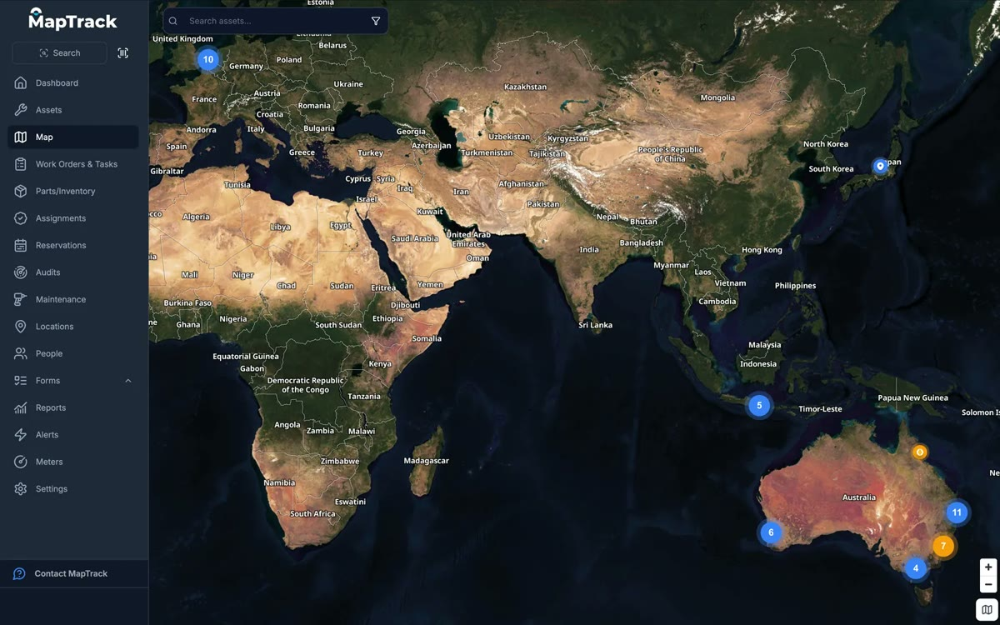
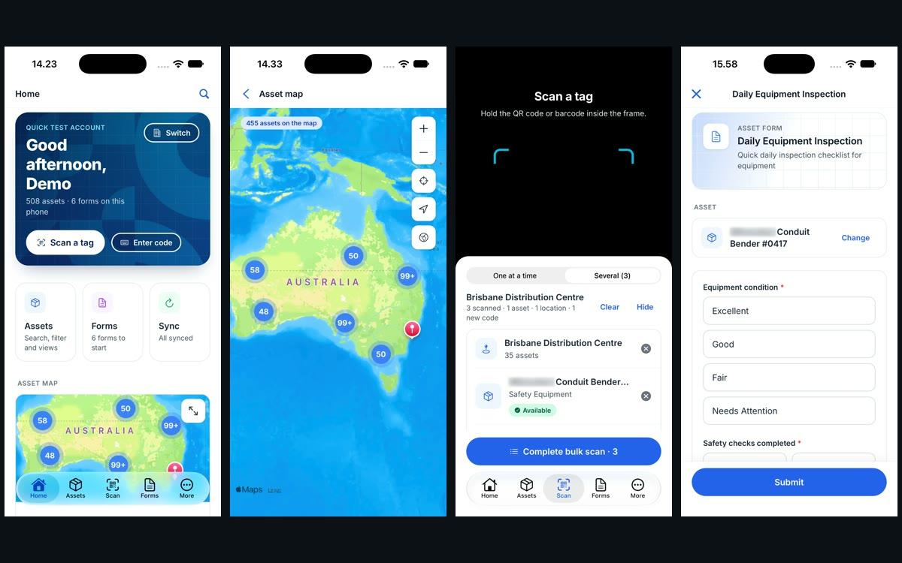
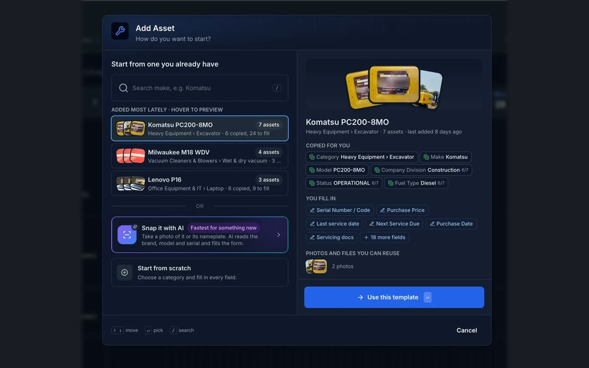
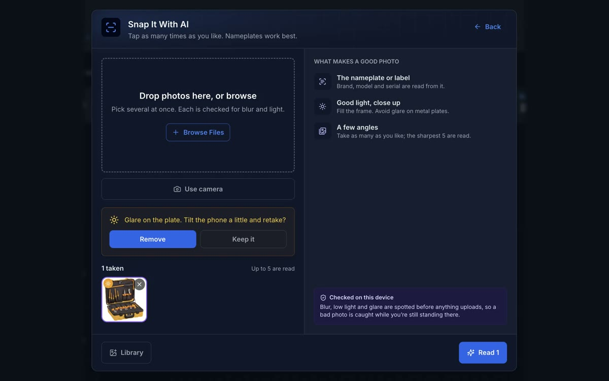
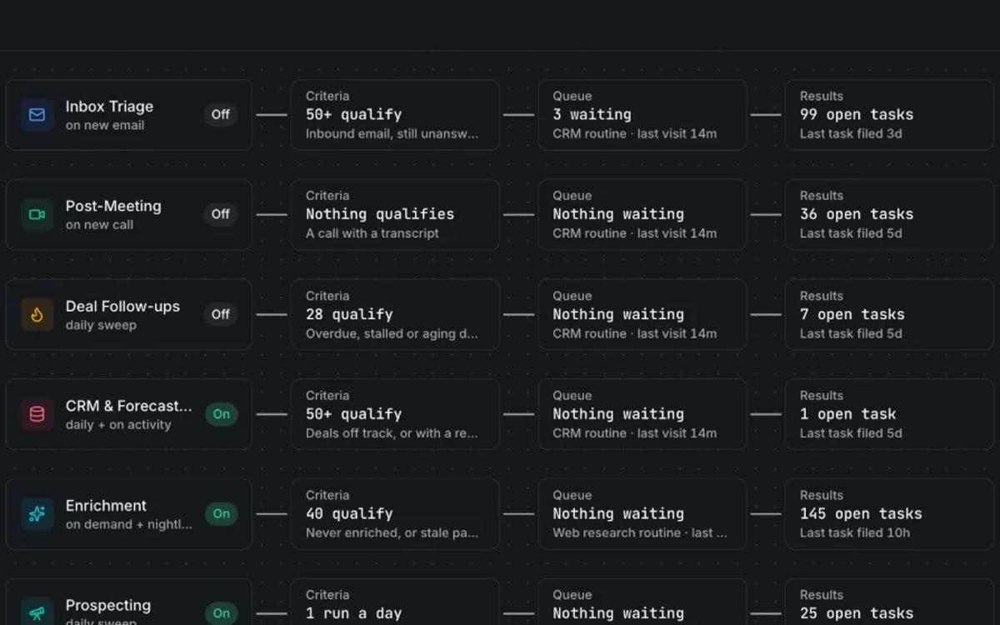
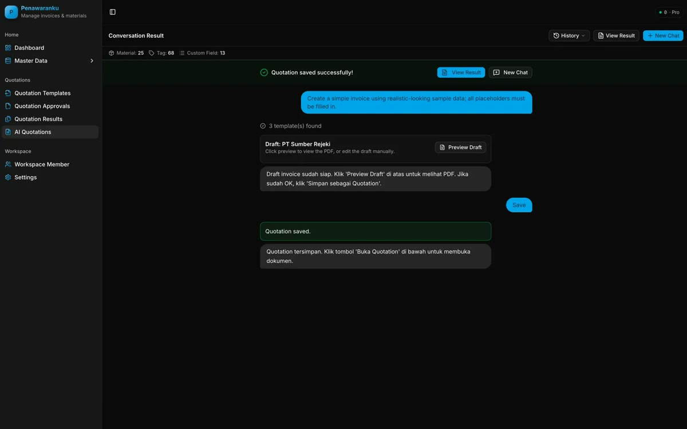

<table>
<tr>
<td colspan="2">

**Hey! Nice to meet you 👋** &nbsp; I'm Hary Arrahman, **Applied AI Engineer · Senior Product Engineer**. Available now · Remote or Jakarta.

</td>
</tr>
<tr>
<td width="50%"></td>
<td width="50%"></td>
</tr>
<tr>
<td width="50%"></td>
<td width="50%"></td>
</tr>
<tr>
<td width="50%"></td>
<td width="50%"></td>
</tr>
<tr>
<td colspan="2">

**languages** 

</td>
</tr>
<tr>
<td colspan="2">

**frontend** 

</td>
</tr>
<tr>
<td colspan="2">

**mobile** 

</td>
</tr>
<tr>
<td colspan="2">

**agents / ai** 

</td>
</tr>
<tr>
<td colspan="2">

**backend & infra** 

</td>
</tr>
<tr>
<td colspan="2">

**quality** 

</td>
</tr>
</table>

## What I've built

- **[BOS](https://haryarrahman.tech/experience/maptrack)**, MapTrack's internal CRM, as founding engineer: replaced HubSpot with 7,400+ records migrated at go-live; now 47,000+ emails, 13,000+ leads, and ~60 MCP tools for AI agents that draft while a person approves.
- **[Form Builder](https://haryarrahman.tech/experience/maptrack)** at MapTrack: drag-and-drop builder and the original form renderer, with conditional logic and repeatable sections through to the exported PDF.
- **[Bosshire](https://haryarrahman.tech/experience/bosshire)**: Lighthouse performance from 30 to 80+ within two months, plus a Next.js 12 to 14 App Router migration.
- **[Edufund](https://haryarrahman.tech/experience/edufund)**: migrated Angular applications to Next.js within three months, then built backend features in Go.
- **[Penawaranku](https://haryarrahman.tech/projects/penawaranku)** (thesis, live): AI cost-estimation (RAB) documents from hybrid RAG in Postgres, pgvector plus full-text search.
- **[ai-service-series](https://github.com/haryarrahman14/ai-service-series)** (public repo, Go): one AI inference request in Python, Go and Rust, where the time goes, measured.

The full stack list, CV and portfolio PDF are on [haryarrahman.tech](https://haryarrahman.tech). Reach me at [haryarrahman14@gmail.com](mailto:haryarrahman14@gmail.com) or on [LinkedIn](https://www.linkedin.com/in/hary-arrahman).
